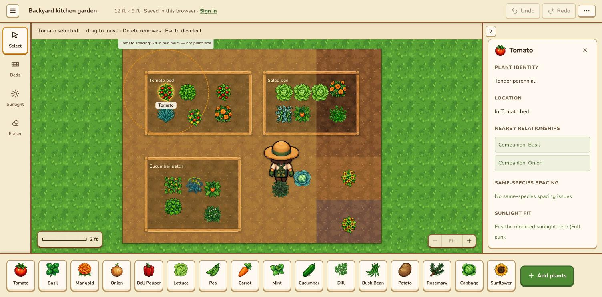
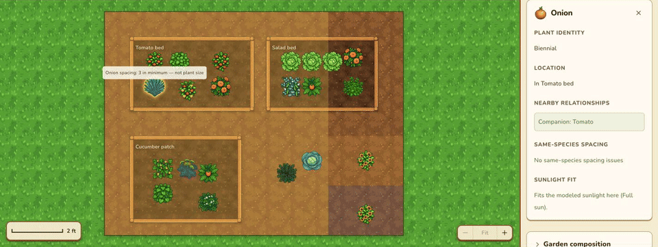
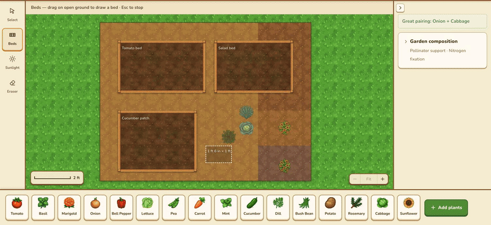
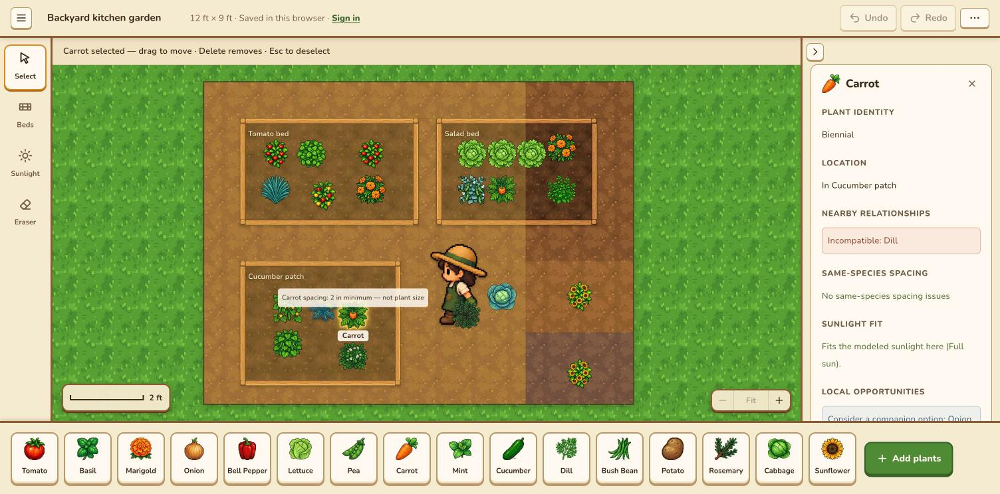
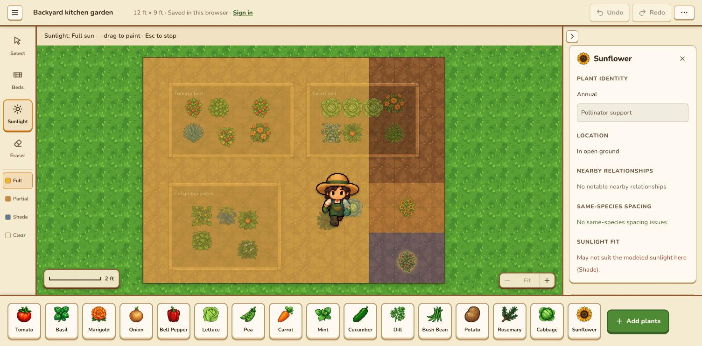
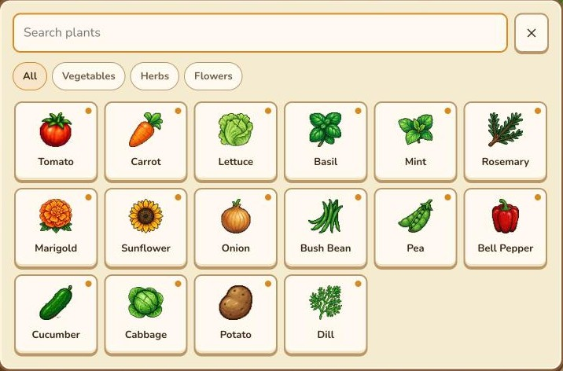
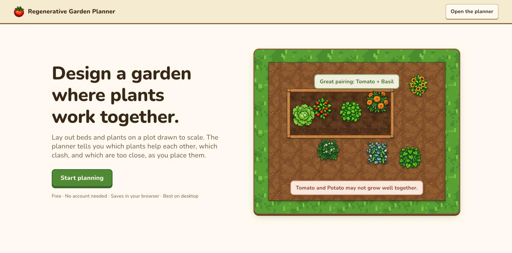

# Regenerative Garden Planner

[](https://github.com/edwardsutton2005/regenerative-garden-planner/actions/workflows/ci.yml)
[](https://regenerative-garden-planner.vercel.app/)

A playful, illustrated garden designer. Lay out beds and plants on a plot drawn to scale, and the planner tells you which plants help each other, which clash, which are too close, and which are in the wrong light, as you place them.

Every piece of feedback comes from curated plant facts and deterministic rules, not from an LLM.

**[Try it live →](https://regenerative-garden-planner.vercel.app/)** · Free · No account needed · Best on desktop



## What It Does

The central idea is that **the garden itself is the interface**. You don't fill in a questionnaire and get a static recommendation. You place and rearrange plants and see what those choices imply.

### Companion feedback while you drag

Pick up a plant and its spacing envelope follows it. Nearby plants light up green for companions and red for incompatible pairs within 12 inches. Drop it and the planner says why.



### Beds, drawn to scale

Draw raised beds by dragging on open ground, then move, resize, rename, or delete them. Plants belong to whichever bed they sit in, and beds move together with their plants. The plot runs from 4 × 4 to 30 × 30 ft and is modeled in real inches, with a scale bar, zoom, and pan.



### Inspect any plant

Select a plant to see its lifecycle, ecological roles, bed, nearby relationships, same-species spacing, sunlight fit, and local companion suggestions. The inspector reflects the garden as it is now, not just your last action.



### Map the sunlight

Paint full sun, partial sun, and shade onto the plot in 12-inch cells. Each plant is checked against its sourced sunlight requirement.



### Pick from a curated catalog

Sixteen vegetables, herbs, and flowers, each with sourced spacing, sunlight needs, lifecycle, and ecological roles. Search or filter, then click to arm a plant for placing. Plants you've used stay in the inventory bar.



### Save anywhere

Gardens save automatically in the browser. Sign in with Google or an emailed link to keep several gardens in your account.

<details>
<summary><strong>Full feature list</strong></summary>

- Configurable rectangular gardens from 4×4 through 30×30 feet, modeled in physical inches
- A free-placement garden canvas: click or drag plants to any position (whole-inch precision), drag them anywhere, erase, clear, and start new gardens
- Spacing envelopes and companion/incompatible highlights while dragging; keyboard placement and movement
- A full-screen workspace: tool rail (Select, Beds, Sunlight brush, Eraser), status line, collapsible inspector, and an inventory bar of plants in use
- A plant catalog popup with search and category filters; choosing a plant arms it for placing
- Undo and redo for garden changes (buttons, Cmd/Ctrl+Z, Shift+Cmd/Ctrl+Z, Ctrl+Y)
- Planting beds: draw, select, move (with their plants), resize, rename, and delete; bed membership is derived from plant position
- A 16-plant catalogue with lifecycle, sourced same-species spacing in inches, and curated ecological roles
- Symmetric companion and incompatible relationship evaluation for plants within 12 inches of each other
- Same-species spacing evaluation using Euclidean distance
- Immediate feedback after placement and movement
- Persistent placement inspection that updates with the current garden state
- Garden composition summaries for represented pollinator-support and nitrogen-fixation roles
- Scoped opportunities for missing garden-wide pollinator support and local companion options
- Claim-level provenance metadata with validation against a source registry
- User-declared sunlight mapping on 12-inch environmental cells for full sun, partial sun, and shade
- Sunlight-fit evaluation against each plant's sourced sunlight requirement
- Illustrated canvas: plant sprites and icons, grass around the plot, soil and bed-soil textures, wooden raised-bed frames, and a wandering gardener (can be turned off)
- Automatic saving in the browser, or, after signing in with Google or an emailed link, to an account with several gardens
- Zoom (buttons, Cmd/Ctrl + = / − / 0, pinch), fit to screen, drag-to-pan, and a map-style scale bar
- A landing page and a privacy page

Sunlight mapping records the user's description of the site; it is not a solar simulation.

</details>



## How It Works

```text
React interactions
      ↓
explicit garden state + curated plant data
      ↓
pure deterministic domain functions
      ↓
structured findings and aggregates
      ↓
transient feedback, inspection, composition, and opportunities
```

`App.tsx` coordinates interaction state and garden mutations. The garden state contains dimensions, plant placements, beds, and modeled environmental state. Framework-independent modules in `src/domain/` evaluate relationships, spacing, sunlight fit, composition, and opportunities. Components render those structured results as user-facing explanations.

Signed out, the garden is saved in the browser. Signing in (Google or an emailed link, through Supabase) saves gardens to an account. There is no custom backend server and no AI API.

## Architecture

Gardening facts and evaluation rules are kept outside React components. Domain functions are deterministic, independently testable, and return enough structured information for the interface to explain their conclusions.

See [ARCHITECTURE.md](./ARCHITECTURE.md) for system boundaries and design decisions, and [docs/reasoning-engine.md](./docs/reasoning-engine.md) for the current facts → reasoning → explanation flow.

## Data and Research

Plant knowledge is curated from horticultural and agricultural references, mostly university Extension pages, rather than generated dynamically. Spacing and sunlight values are sourced per plant. The repository keeps normalized application facts separate from evidence metadata, so reasoning stays stable while provenance becomes more complete over time.

Current provenance is incomplete at the individual-claim level and is documented transparently in [docs/data-sources.md](./docs/data-sources.md).

## Tech Stack

- React 19, TypeScript 6, Vite 8 (multi-page: landing, planner, privacy)
- Plain CSS
- Supabase (auth and saved gardens, with row level security)
- Vitest 4, Oxlint, GitHub Actions
- Deployed on Vercel

## Running Locally

Requirements: Node.js `20.19+` or `22.12+` and npm.

```bash
npm install
npm run dev
```

The landing page is at `/`, the planner at `/plan/`, and the privacy page at `/privacy/`.

### Accounts

Sign-in and saved gardens need a Supabase project. Without one, the planner runs and saves only in the browser. To enable them:

1. Copy `.env.example` to `.env.local` and fill in `VITE_SUPABASE_URL` and `VITE_SUPABASE_PUBLISHABLE_KEY` from the Supabase project's API settings. Both are public by design: row level security keeps each user's gardens private.
2. Apply `supabase/migrations/` to the project.
3. In Supabase, under Authentication → URL Configuration, allow `http://localhost:5173/**` and the deployed site as redirect URLs. Google sign-in also needs the Google provider configured with an OAuth client.

Create a production build and preview it locally with:

```bash
npm run build
npm run preview
```

## Testing

```bash
npm test          # deterministic domain and data tests
npm run lint
npm run build
```

The test suite covers garden-state invariants, coordinate boundaries, relationship symmetry and conflicts, spacing boundaries, sunlight fit, composition, opportunity policies, saved-plan validation, and data/provenance integrity. Pure helpers behind the canvas and art build (screen↔inch conversion, spacing previews, scale-bar lengths, textures, background removal) are tested too. Drag interactions, zoom/pan, and visual layout are verified manually in the browser.

GitHub Actions runs lint, tests, and build on every push and pull request (`.github/workflows/ci.yml`).

## Plant Art Pipeline

The plant sprites and icons were generated with Google's Gemini image API from locked Tomato style references. Newer pieces (the mint icon, the bed planks, the gardener) come from ChatGPT-made sheets that are cut and processed in code. Ground textures are generated in code. This is development-time tooling only; no image API is used by the app. See [art/STYLE.md](./art/STYLE.md) for the art direction, folder layout, and approval workflow.

```bash
cp .env.example .env.local          # then set GEMINI_API_KEY in .env.local
npm run art:generate -- basil sunflower
npm run art:build                   # approved art + textures + bed frame → public/art/
```

## Roadmap

Near-term work described in [PRODUCT.md](./PRODUCT.md) is the rest of the canvas-first workspace: a Strengths / Issues / Opportunities inspector with Find plants / Show me actions, and short-lived canvas feedback. Longer-term directions include more environmental context and richer ecological systems. These are planned, not implemented.
