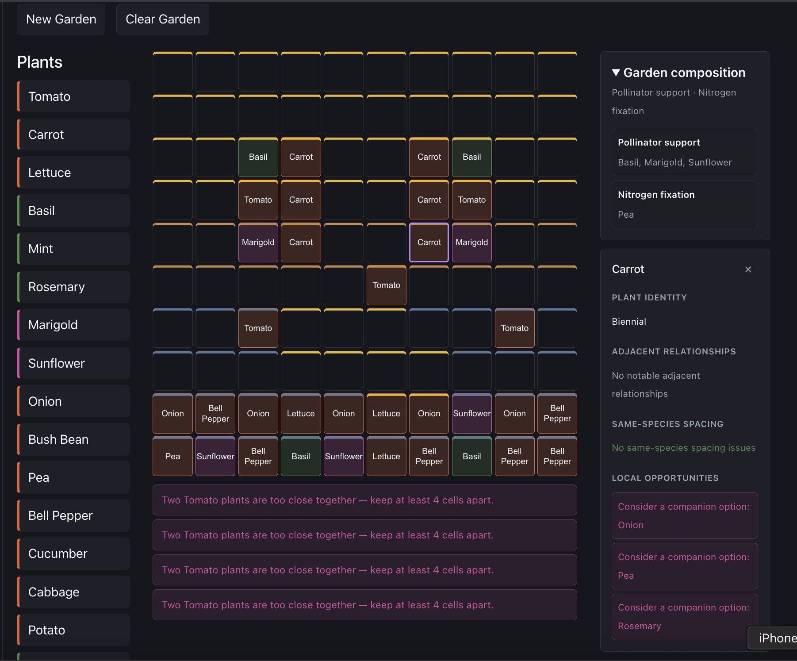

# Regenerative Garden Planner

An interactive garden-design application that evaluates a spatial layout using curated plant facts and deterministic rules. It helps users explore companion relationships, spacing, ecological roles, and environmental conditions without treating an LLM as the source of gardening knowledge.


**Live demo:** _Coming soon_

**Screenshot/demo GIF:** 

## Overview

The central product idea is: **the garden itself is the interface**.

Instead of completing a questionnaire and receiving a static recommendation, a user creates a garden, places and rearranges plants, and sees what those choices imply. Immediate feedback explains a recent action, while persistent inspection describes the current state of a placement. Garden-level summaries show which modeled ecological roles are represented and surface a deliberately small set of explainable opportunities.

The project is designed as a compact test bed for spatial interaction and transparent ecological reasoning. It favors explicit data and rules over opaque scoring or generated horticultural claims.

## Current Features

- Configurable rectangular gardens from 4×4 through 30×30 feet, modeled in physical inches
- A free-placement garden canvas: click or drag plants to any position (whole-inch precision), drag them anywhere, erase, clear, and start new gardens
- Spacing envelopes and companion/incompatible highlights while dragging; keyboard placement and movement
- A full-screen workspace: tool rail (Select, Beds, Sunlight brush, Eraser), status line, collapsible inspector, and an inventory bar of plants in use
- A plant catalog popup with search and category filters; choosing a plant arms it for placing
- Undo and redo for garden changes (buttons, Cmd/Ctrl+Z, Shift+Cmd/Ctrl+Z, Ctrl+Y)
- Planting beds: draw, select, move (with their plants), resize, rename, and delete; bed membership is derived from plant position
- A 16-plant catalogue with lifecycle, sourced same-species spacing in inches, and curated ecological roles
- Symmetric companion and incompatible relationship evaluation for plants within 12 inches of each other
- Same-species spacing evaluation using Euclidean distance
- Immediate feedback after placement and movement
- Persistent placement inspection that updates with the current garden state
- Garden composition summaries for represented pollinator-support and nitrogen-fixation roles
- Scoped opportunities for missing garden-wide pollinator support and local companion options
- Claim-level provenance metadata with validation against a source registry
- User-declared sunlight mapping on 12-inch environmental cells for full sun, partial sun, and shade
- Sunlight-fit evaluation against each plant's sourced sunlight requirement
- Illustrated canvas: plant sprites and icons, grass around the plot, soil and bed-soil textures, wooden raised-bed frames
- Zoom (buttons, Cmd/Ctrl + = / − / 0, pinch), fit to screen, drag-to-pan, and a map-style scale bar

Sunlight mapping records the user's description of the site.

## How It Works

```text
React interactions
      ↓
explicit garden state + curated plant data
      ↓
pure deterministic domain functions
      ↓
structured findings and aggregates
      ↓
transient feedback, inspection, composition, and opportunities
```

`App.tsx` coordinates interaction state and garden mutations. The garden state contains dimensions, plant placements, and modeled environmental state. Framework-independent modules in `src/domain/` evaluate relationships, spacing, composition, and opportunities. Components render those structured results as user-facing explanations.

No backend, account system, persistence layer, or AI API is currently involved.

## Architecture

Gardening facts and evaluation rules are kept outside React components. Domain functions are deterministic, independently testable, and return enough structured information for the interface to explain their conclusions.

See [ARCHITECTURE.md](./ARCHITECTURE.md) for system boundaries and design decisions, and [docs/reasoning-engine.md](./docs/reasoning-engine.md) for the current facts → reasoning → explanation flow.

## Data and Research

Plant knowledge is curated from horticultural and agricultural references rather than generated dynamically. The repository distinguishes normalized application facts from evidence metadata so reasoning remains stable while provenance can become more complete over time.

Current provenance is incomplete at the individual-claim level and is documented transparently in [docs/data-sources.md](./docs/data-sources.md).

## Tech Stack

- React 19
- TypeScript 6
- Vite 8
- CSS
- Vitest 4
- Oxlint
- npm

## Running Locally

Requirements: Node.js `20.19+` or `22.12+` and npm.

```bash
npm install
npm run dev
```

Create a production build and preview it locally with:

```bash
npm run build
npm run preview
```

## Testing

Run the deterministic domain and data tests:

```bash
npm test
```

Run all repository checks:

```bash
npm test
npm run lint
npm run build
```

The test suite covers garden-state invariants, coordinate boundaries, relationship symmetry and conflicts, spacing boundaries, composition, opportunity policies, and data/provenance integrity. Pure helpers behind the canvas and art build (screen↔inch conversion, spacing previews, scale-bar lengths, textures, background removal) are tested too. Drag interactions, zoom/pan, and visual layout are verified manually in the browser.

## Plant Art Pipeline

Plant sprites and icons are generated with Google's Gemini image API from locked Tomato style references. The bed frame comes from a ChatGPT-made plank sheet; ground textures are generated in code. This is a development-time tool only; the API key is never used by the app. See [art/STYLE.md](./art/STYLE.md) for the art direction, folder layout, and approval workflow.

```bash
cp .env.example .env.local          # then set GEMINI_API_KEY in .env.local
npm run art:generate -- basil sunflower
npm run art:build                   # approved art + textures + bed frame → public/art/
```

## Roadmap

Near-term work described in [PRODUCT.md](./PRODUCT.md) is the rest of the canvas-first workspace: the Strengths / Issues / Opportunities inspector with Find plants / Show me, and short-lived canvas feedback. Longer-term directions include additional environmental context and richer ecological systems, but those remain planned rather than implemented.
